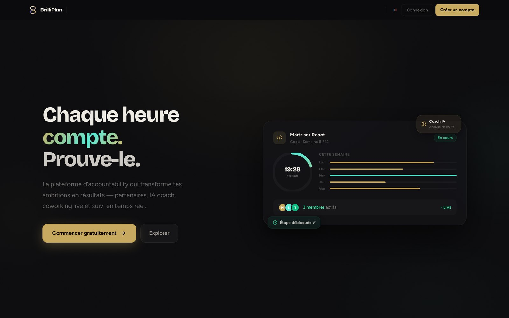
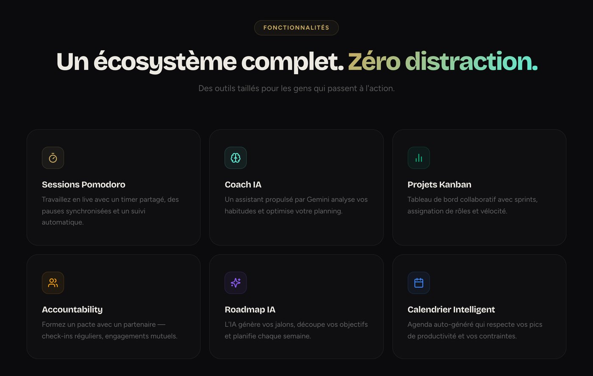
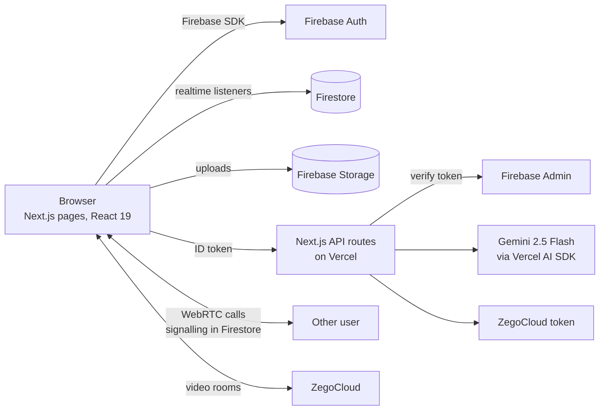
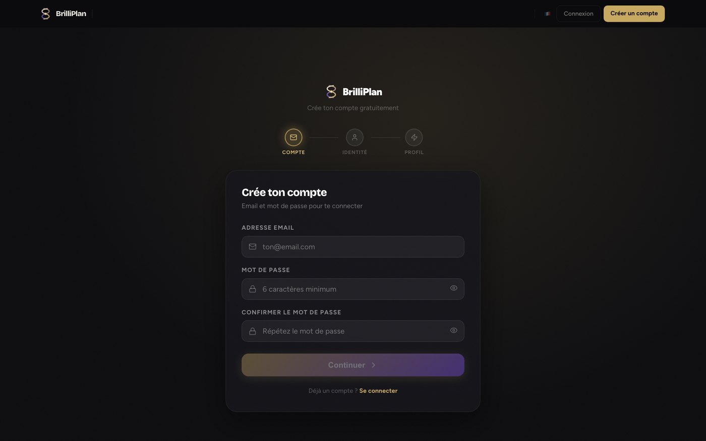

# BrilliPlan

**Reach your goals together.** BrilliPlan is a web app for people working on long-term goals
(learning to code, writing a book, getting back into sport) who stay consistent better with
other people around them. You set an objective, an AI coach turns it into a roadmap, and you
work on it in live coworking sessions, with an accountability partner and a team if you want
one.

**Live app: [brilliplan-app.vercel.app](https://brilliplan-app.vercel.app)**



Built with Next.js 15, React 19, TypeScript, Firebase (Auth, Firestore, Storage), Gemini 2.5
Flash through the Vercel AI SDK, WebRTC and ZegoCloud for video. Deployed on Vercel. The
interface is in French, with an English mode.

## Features

**Goals and planning**
- Objectives with a target number of hours and a category, with progress tracked against the
  hours you log
- AI roadmap: the coach splits a goal into phases, milestones and weekly steps
- AI resources: five courses, docs or tools picked for the current stage of the roadmap
- Calendar with an AI-generated agenda that respects each person's productive hours, and
  detection of overloaded weeks across a team

**Working together**
- Coworking rooms ("salons"), public or private with invite links
- Live sessions with a shared Pomodoro timer, synchronised breaks and automatic time tracking
- Ambient sounds (rain, lo-fi) during focus sessions
- Video calls over WebRTC (signalling through Firestore) and ZegoCloud video rooms
- Collaborative whiteboard and PDF annotation in sessions, objectives and projects
- Direct messages and room chat with an AI assistant that knows the room's context
- Team projects with a Kanban board, sprints, roles and velocity
- "Find teammates": post open roles and skills for an objective or project, and review
  applicants

**Accountability**
- Pacts between two partners, with daily check-ins and weekly commitments
- An AI accountability coach that reviews the pair's progress
- "Focus Guard", which nudges a pair back on track when they drift

**Motivation**
- XP, levels, badges (night owl, early bird, streaks...) and a leaderboard
- Daily streaks, a weekly report and a weekly check-in
- A discipline profile: the AI reads your activity and gives you a work-style archetype

**Accounts and safety**
- Email sign-up with verification, public profiles at `/u/<username>`
- Friends, blocking and reporting



## AI features

All AI calls go through Next.js API routes, so the Gemini key never reaches the browser. Each
route checks the user's Firebase token and is rate-limited.

| Route | What it does |
|---|---|
| `generate-roadmap` | Turns an objective or project into phases and weekly steps |
| `generate-milestones` | Creates concrete milestones for each roadmap phase |
| `generate-resources` | Suggests learning resources for the goal |
| `generate-agenda`, `generate-smart-agenda` | Plans sessions for a group around everyone's constraints |
| `detect-conflicts` | Looks at a team's next 30 days and flags overloaded people or weeks |
| `chat-coach` | Personal coach chat about one objective |
| `salon-ai` | Assistant inside a coworking room, aware of the room's goal and tasks |
| `accountability-coach` | Reviews an accountability pair's progress and suggests next steps |
| `focus-guard` | Short nudges for a pair that is losing focus |
| `discipline-profile` | Builds a work-style profile from the user's session history |

## Architecture



- **Frontend:** Next.js App Router, React 19, Framer Motion for animations, lucide icons,
  a custom design system (`src/app/design-system.css`), French/English translations in
  `src/i18n`.
- **Data:** Firestore with realtime listeners. Main collections: users, objectives, projects,
  memberships, accountability pairs, messages, direct messages, notifications, session logs,
  friendships, teammate requests, calls.
- **Security:** Firestore security rules for every collection, server-side token checks with
  the Firebase Admin SDK, a rate limiter on the API routes, CSRF checks on the `Origin` and
  `Referer` headers in `middleware.ts`, a Content Security Policy and other security headers in
  `next.config.ts`, input sanitising and upload validation.
- **Hosting:** Vercel, Paris region (`cdg1`).



## Run it locally

You need Node.js 20+, a Firebase project (Auth with email/password, Firestore and Storage
enabled), a Gemini API key and, for video rooms, a ZegoCloud app.

```bash
git clone https://github.com/fareszid/brilliplan-app.git
cd brilliplan-app
npm install
cp .env.example .env.local      # then fill in the keys
npm run dev                     # http://localhost:3000
```

Deploy the Firestore security rules to your Firebase project:

```bash
npx firebase-tools deploy --only firestore:rules
```

| Variable | Used for |
|---|---|
| `NEXT_PUBLIC_FIREBASE_*` | Firebase web config (public by design) |
| `GOOGLE_GENERATIVE_AI_API_KEY` | Gemini calls from the API routes |
| `NEXT_PUBLIC_ZEGO_APP_ID`, `ZEGO_SERVER_SECRET` | ZegoCloud video rooms |
| `FIREBASE_SERVICE_ACCOUNT_KEY` | Server-side token verification (Firebase Admin) |

## Project structure

```
src/
├── app/
│   ├── page.tsx                 # landing page
│   ├── dashboard/               # your objectives, rooms and activity
│   ├── objective/[id]/          # an objective: roadmap, milestones, resources, sessions
│   ├── project/[id]/            # a team project: Kanban, sprints, roles
│   ├── session/                 # live focus session
│   ├── accountability/          # partner pacts and check-ins
│   ├── find-teammates/          # people and project matching
│   ├── messages/  calendar/  friends/  leaderboard/  profile/  u/[username]/
│   └── api/                     # AI routes, video token, file proxies
├── components/                  # whiteboard, PDF annotation, ambient player, reports...
├── context/                     # auth, calls, live sessions, gamification, language
├── i18n/                        # French and English strings
└── lib/                         # Firebase clients, rate limiting, sanitising, streaks
firestore.rules                  # security rules
```

## What's next

- Automated tests (rules tests with the Firebase emulator, then end-to-end tests of the main
  flows)
- A shared rate limiter (Redis / Upstash) instead of the in-memory one, which only works per
  server instance
- Finishing the English translation of every screen

## Author

Built by [Fares Zid](https://github.com/fareszid).
